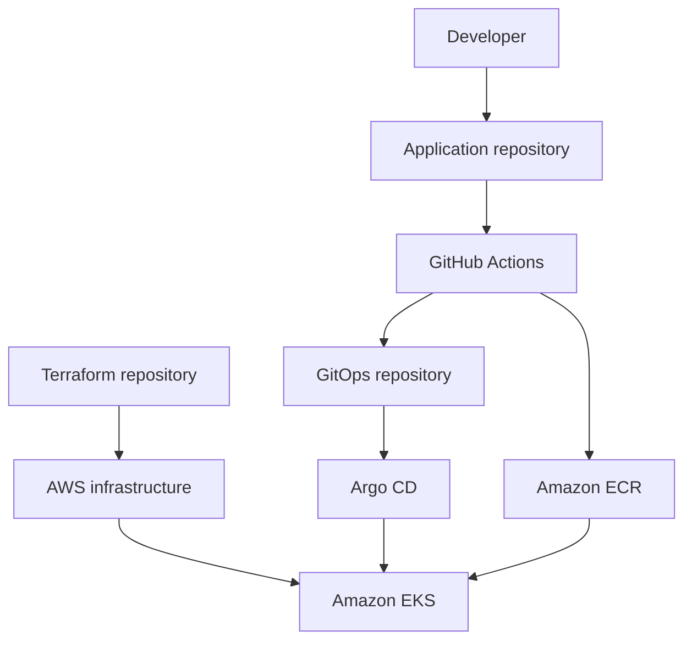

# Amazon EKS GitOps Platform with Terraform

[](https://github.com/TechWorld707/terraform-aws-eks-gitops-platform/actions/workflows/terraform-pr.yml)

A production-oriented Amazon EKS platform provisioned with Terraform and designed for secure, automated application delivery through GitHub Actions and Argo CD.

This project demonstrates Kubernetes platform engineering, infrastructure as code, GitOps delivery, AWS identity management, container security, observability, software supply-chain controls, and automated rollback.

## Platform overview

The solution is separated into three repositories to establish clear ownership boundaries between infrastructure, application source code, and deployment configuration.

| Repository | Responsibility |
| --- | --- |
| [`terraform-aws-eks-gitops-platform`](https://github.com/TechWorld707/terraform-aws-eks-gitops-platform) | Provisions the AWS infrastructure, EKS cluster, ECR repositories, identity controls, and initial platform add-ons |
| [`three-tier-eks-application`](https://github.com/TechWorld707/three-tier-eks-application) | Contains the frontend and API source code, tests, and container build definitions |
| [`three-tier-eks-gitops`](https://github.com/TechWorld707/three-tier-eks-gitops) | Defines the desired Kubernetes and Helm configuration continuously reconciled by Argo CD |

## Delivery architecture



The application pipeline builds and validates container images before publishing them to Amazon ECR. Deployment state is stored separately in the GitOps repository and continuously reconciled with the EKS cluster by Argo CD.

## Architecture ownership

### Terraform-managed infrastructure

Terraform provisions and manages:

- VPC
- Public and private subnets
- Routing and NAT gateways
- VPC endpoints
- Amazon EKS control plane
- EKS managed node groups
- Amazon ECR repositories
- AWS KMS keys
- IAM roles and policies
- AWS-managed EKS add-ons
- Initial platform bootstrap

### Platform add-ons

A separate Terraform state installs the initial platform services:

- Argo CD
- AWS Load Balancer Controller
- ExternalDNS
- External Secrets Operator
- Metrics Server
- Required Kubernetes namespaces
- Autoscaling prerequisites

### GitOps-managed resources

After Argo CD is operational, the GitOps repository manages:

- Frontend workloads
- API workloads
- Kubernetes Services
- Ingress resources
- ConfigMaps
- Horizontal Pod Autoscalers
- NetworkPolicies
- Application image digests
- Application updates and rollbacks

## State separation

The development environment uses two independent Terraform roots:

```text
environments/dev/foundation
environments/dev/addons
## Development observability

The `environments/dev/addons` stack installs Prometheus, Alertmanager, Grafana,
Blackbox Exporter, Fluent Bit, an OpenTelemetry Collector, and single-binary Tempo.
Apply the add-ons before syncing the GitOps monitoring resources so the Prometheus
Operator CRDs exist. Prometheus and Tempo each request a 10 GiB encrypted gp3
volume. Prometheus retains up to seven days or 8 GB and Tempo retains 48 hours.
Fluent Bit ships logs from `three-tier-dev` to
`/aws/eks/<cluster-name>/three-tier-dev` with 14-day retention. EKS already publishes
control-plane logs to `/aws/eks/<cluster-name>/cluster`. Grafana and Fluent Bit use
EKS Pod Identity for their respective CloudWatch access.

After the application Ingress provisions an ALB, set `observability_alb` with its
ALB and frontend target group ARN suffixes to create the unhealthy-target alarm.
The optional SNS topic must allow CloudWatch to publish and have confirmed subscribers.
For application notifications, create a Secret in `monitoring` with the
`alertmanager.yaml` key and set `observability_alertmanager_config_secret` to its
name. Until a receiver is configured, application alerts are visible in Alertmanager.
